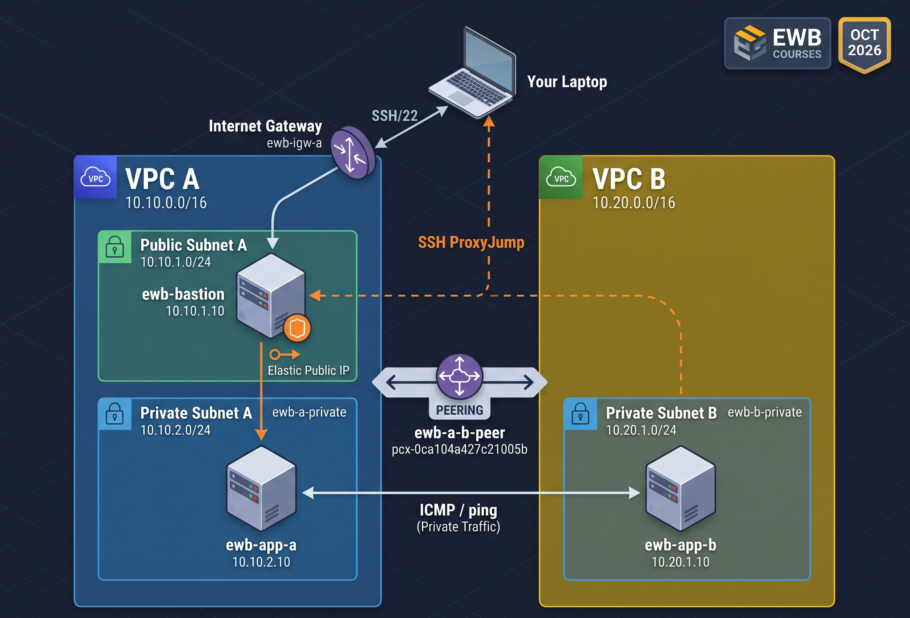

# AWS VPC Peering & Private Connectivity 🚀

This repository contains the deliverables for the AWS VPC Peering project completed as part of the EWB Courses & AICTE AWS Internship.

## Project Overview
The objective of this project was to establish a private network connection between two isolated VPCs using AWS VPC Peering and demonstrate private connectivity while maintaining security.

## Deliverables Included
- **`Jayasurya_EWB_VPC_Peering.pdf`**: The comprehensive project workbook containing architecture details, resource inventory, configuration screenshots, and testing proofs (Baseline failure, Forward/Reverse Ping, ProxyJump SSH, and Controlled ICMP Failure).

## Key Technologies Used
- Amazon Virtual Private Cloud (VPC) & Subnets
- VPC Peering
- Amazon EC2 (Bastion Host, App Servers)
- Custom Route Tables & Internet Gateways
- Security Groups (SSH & ICMP rules)
- SSH ProxyJump

## 🏗️ Architecture & Resource Inventory

### 📝 Resource Details

| Resource Name | Type | CIDR / IP Address | Actual Resource ID |
| :--- | :--- | :--- | :--- |
| **ewb-vpc-a** | VPC A | 10.10.0.0/16 | vpc-0019f503c48931c38 |
| **ewb-vpc-b** | VPC B | 10.20.0.0/16 | vpc-050298481c0fe2bc5 |
| **ewb-a-public** | Subnet (VPC A) | 10.10.1.0/24 | subnet-073da1d9a1b26ce45 |
| **ewb-a-private** | Subnet (VPC A) | 10.10.2.0/24 | subnet-0e72d502cdf9f24c1 |
| **ewb-b-private** | Subnet (VPC B) | 10.20.1.0/24 | subnet-0b1db0a023c9e21d1 |
| **ewb-a-b-peer** | Peering Connection | N/A | pcx-0ca104a427c21005b |
| **ewb-bastion** | EC2 Instance | 10.10.1.10 (Private) | i-08ea40a3c3cd90f1c |
| **ewb-app-a** | EC2 Instance | 10.10.2.10 (Private) | i-0ca7e54b41e54b870 |
| **ewb-app-b** | EC2 Instance | 10.20.1.10 (Private) | i-079e004bddf4d2865 |

## ⚙️ Configuration Setup

**1. VPCs & Subnets**
- Created two custom VPCs and corresponding public/private subnets.

**2. Route Tables**
- Configured explicit subnet associations and routing rules.
- **Public Route Table:** Routed `0.0.0.0/0` to the Internet Gateway (`igw-05f1fb889117115dd`).
- **Private Route Tables:** Added explicit routes targeting the VPC Peering connection.

**3. VPC Peering**
- Successfully established and activated a peering connection between `ewb-vpc-a` and `ewb-vpc-b`.

**4. Security Groups**
- Implemented strict firewall rules. 
- SSH access is restricted to the Bastion host's private IP (`10.10.1.10/32`). 
- ICMP (Ping) is restricted to specific private IPs of the App servers.

## 🧪 Testing Proofs & Explanations

### Test 01: Baseline Failure
- **Action:** Attempted to ping App-B from App-A before configuring VPC Peering.
- **Explanation:** Before setting up the VPC Peering and routing, App-A could not reach App-B. The ping resulted in 100% packet loss because there was no route connecting the two isolated VPC networks.

### Test 02: Forward & Reverse Path Ping Success
- **Action:** Pinging App-B from App-A (Forward) and App-A from App-B (Reverse) after peering and route table setup.
- **Routing Explanation:**
  - **Forward Path:** When App-A (`10.10.2.10`) pings App-B (`10.20.1.10`), the traffic goes to VPC A's private route table. The route table checks the destination (`10.20.0.0/16`) and forwards the traffic to the Active Peering Connection (`pcx-...`). App-B's Security Group allows this incoming ICMP traffic.
  - **Return Path:** For the ping reply to come back, VPC B's private route table directs the return traffic (`10.10.0.0/16`) back through the same Peering Connection. Without this return route, the ping would fail.

### Test 03: Private SSH Access (Proxy Jump)
- **Action:** Connected to the private App-B instance from the local machine.
- **Explanation:** Connected successfully to the private App-B instance from the local laptop using the Bastion host's public IP as an SSH ProxyJump.

### Test 04: Controlled ICMP Failure & Recovery
- **Action:** Temporarily removed the ICMP rule from App-B's security group.
- **Explanation:** I temporarily removed the ICMP Echo Request rule from App-B's security group. As a result, the ping from App-A immediately failed. This proves that even with correct routing (VPC Peering), the instance-level firewall (Security Group) must explicitly allow the traffic for communication to happen. Once the rule was added back, the ping recovered successfully.

## 🧹 Cleanup Declaration
I confirm that all resources (EC2 instances, Peering connections, IGW, Subnets, and VPCs) created for this lab have been successfully terminated and deleted to prevent unwanted billing.
